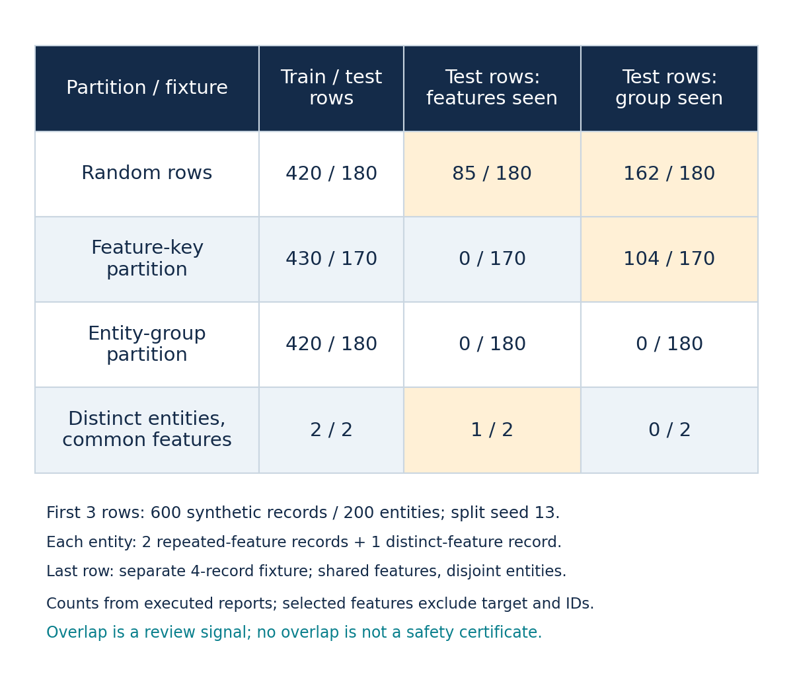
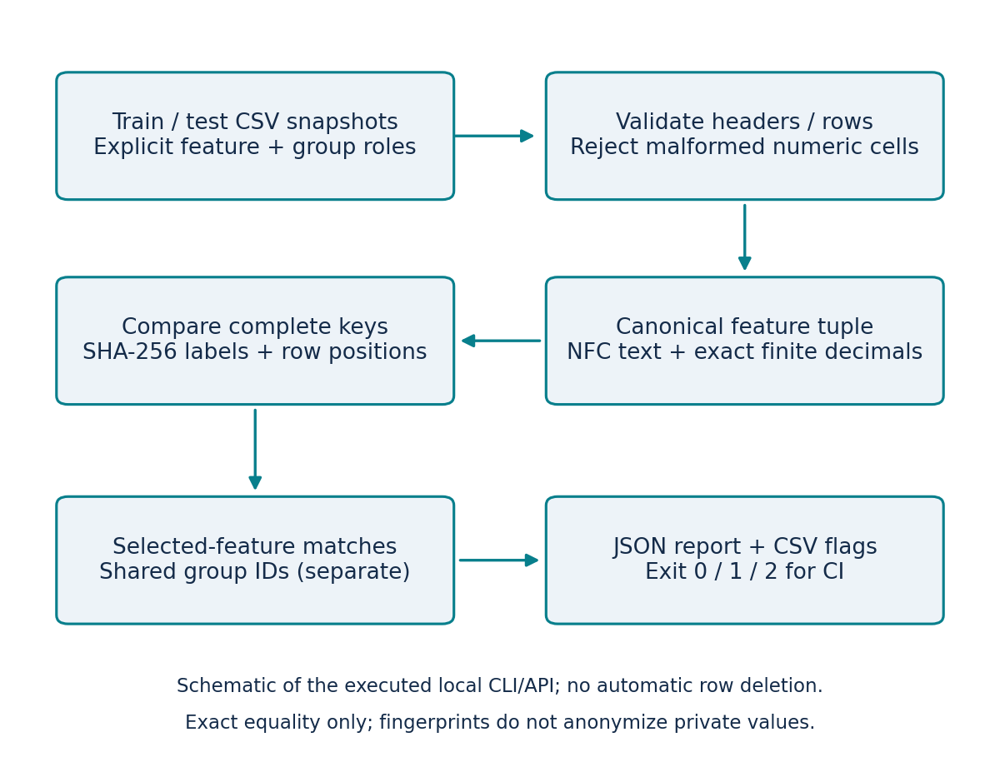

# Split Overlap Auditor

A local tool for analysts and ML developers who need to inspect repeated feature rows or shared entities across train/test CSV files. It produces a JSON evidence report, per-test-row CSV flags and exit codes that can gate a CI job.

**Local CLI/API release. Python 3.12 standard library; no account, API key, upload service or model download.** Inputs are never edited. Warnings require human interpretation: two independent entities can have identical selected features, and some prediction tasks intentionally evaluate new observations from known entities.

## Run a useful audit

Clone/download the repository, enter its folder, then run this command using Python 3.12. Core use requires no package installation.

```sh
python split_audit.py --train fixtures/random_rows-seed-13/train.csv --test fixtures/random_rows-seed-13/test.csv --features measurement channel --numeric measurement --group entity --target target --output local-output/row-audit --fail-on-overlap
```

The supplied synthetic example should return exit **1** because overlaps exist, while writing `local-output/row-audit/report.json` and `test-row-flags.csv`. Inspect `feature_matches` and `group_matches` separately. Each gives a fingerprint and one-based **data-record positions**, not physical file line numbers. Do not automatically delete flagged rows.

Compare the entity-disjoint example:

```sh
python split_audit.py --train fixtures/group_partition-seed-13/train.csv --test fixtures/group_partition-seed-13/test.csv --features measurement channel --numeric measurement --group entity --target target --output local-output/group-audit --fail-on-overlap
```

That supplied fixture should return exit **0**. It means no selected-feature/group intersections were found, not that every possible leakage mechanism was ruled out. Without `--fail-on-overlap`, a completed audit returns 0 even when warnings exist. Malformed input returns **2**. Existing output files require a new directory or explicit `--overwrite`; input files cannot be report targets.

For your own CSVs, explicitly choose the model-input columns, numeric subset and entity/group identifier. Exclude targets and irrelevant row IDs. Use `--target` to prevent accidentally including the named target in the fingerprint. Without `--group`, group checking is marked **not run**, rather than reported as zero overlap.

## What the checked experiment found

The declared fixture family has 600 synthetic records from 200 entities. Each entity contributes two equivalent feature records and one different record. We executed random-row, feature-key and entity-group partitioning at preset seeds 13, 29 and 47, plus an independent-entity common-value counterexample. No models were fitted.

| Seed-13 partition | Train/test rows | Test rows with features seen in train | Test rows with group seen in train |
| --- | ---: | ---: | ---: |
| Random rows | 420 / 180 | 85 / 180 | 162 / 180 |
| Feature-key partition | 430 / 170 | 0 / 170 | 104 / 170 |
| Entity-group partition | 420 / 180 | 0 / 180 | 0 / 180 |

All ten case reports matched expected counts calculated from separate generator identity metadata. All **44 automated checks passed, with zero skips**. The unchecked baseline emits no warnings and therefore misses every known intersection. All source rows were retained and repeated auditor runs were identical. The partition methods have different test rows/sizes; this is a functionality/stress test, **not a matched model-accuracy comparison or independent enterprise validation**.



Feature-key partitioning removed exact selected-feature intersections in this fixture but still placed some entities on both sides. Conversely, the separate four-row fixture has a common feature tuple across distinct entities: the warning correctly reports matching values and does not establish contamination. Review the evaluation question and source identities.

## Exact equivalence policy

- Text: Unicode NFC normalization; case and whitespace retained. Empty string is missing, distinct from the literal text `missing`.
- Explicit numeric columns: finite exact Decimal parsing; surrounding whitespace stripped; equivalent notation and signed zero canonicalized. No rounding tolerance or inferred types. Whitespace-only numeric cells are missing.
- Selected-feature keys include column names and typed tokens, sorted by name. The target is excluded when its role is supplied.
- Full canonical byte strings determine equality; SHA-256 supplies report labels. A simulated digest-collision test verifies that digest equality cannot create a false match.
- Groups use explicit NFC-normalized text identity, with case/whitespace retained. Empty or whitespace-only IDs fail validation.
- All-selected-features-missing rows are counted and warned about. They can produce uninformative matches.



Reports contain positions and digests rather than raw cell values. **Digests are not anonymization**; low-entropy values can be guessed. Keep reports derived from private data private. Input bytes are hashed from the same bounded snapshot that was parsed. No telemetry or external transmission is present.

## Reproduce, test and integrate

```sh
python -m unittest -v test_split_audit.py
python run_experiment.py --output local-output/reproduction
# Optional figure tooling only:
python -m pip install -r requirements-figures.txt
python render_figures.py
```

The original [results](experiments/2026-10-16/results.json), [all summary rows](experiments/2026-10-16/summary.csv), case JSON/CSV outputs and test log are retained. See the predeclared [protocol](PROTOCOL.md), [configuration](config.json), [fixture hashes and licence](fixtures/fixture-manifest.json), [source ledger](sources.json) and editable SVG figures. The CLI examples were executed and their report/stdout/exit-code parity checked; see `experiments/2026-10-16/cli-workflows.json`.

```python
from split_audit import audit, read_csv

report = audit(
    read_csv("train.csv"), read_csv("test.csv"),
    ["measurement", "channel"], numeric_columns=["measurement"],
    group_column="entity", target_column="target",
)
print(report["counts"], report["warnings"])
```

Dictionary indexing avoids comparing every train row with every test row. Canonicalization processes the selected cell content and sorts feature names; deterministic report ordering also sorts shared keys. Stored inputs, canonical keys, row positions and reports require proportional memory. This is an algorithmic description, not a measured latency or scale benchmark. Limits: 5 MB/input, 50,000 rows/input, 128 CSV columns, at most 64 selected features, and 4,096 characters/cell (256 in numeric cells).

## Limits

Exact equality cannot find approximate duplicates, time/arrival leakage, target proxies, unrecorded group identity or inappropriate evaluation policies. Group separation alone does not guarantee chronology or representative deployment conditions. The fixtures are authored and development-visible. There is no fitted-model accuracy claim, public hosted demo, security audit or production deployment claim. Browser access was unavailable during preparation; this release is a verified command-line tool, not a tested browser interface.

All code and freshly authored synthetic fixtures are MIT-licensed. Matplotlib is optional for figures and retains its own licence. No private, customer or employer code/data is included.


## Churn Decision Lab — model-backed local app

The new [Churn Decision Lab](churn/README.md) adds an executed UCI churn benchmark, separate sigmoid calibration, explicit review-capacity policies and a local browser runner with checked JSON/CSV exports. All original split-auditor work above remains available. The calibration result is mixed/negative; see all three seeds and limitations in the module README.

## Educational clustering example

[K-means vs DBSCAN: what each calls a cluster](education/clustering-definitions/README.md) adds an executed synthetic teaching example, independent centroid/density checks, saved fit/probe outputs and an original infographic. It makes no real-customer or comparative-accuracy claim.
