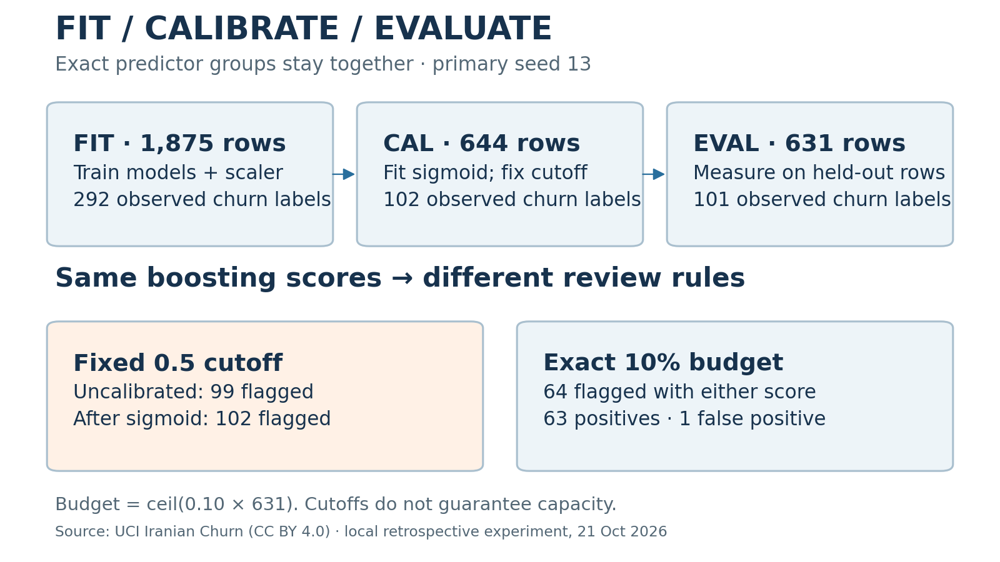
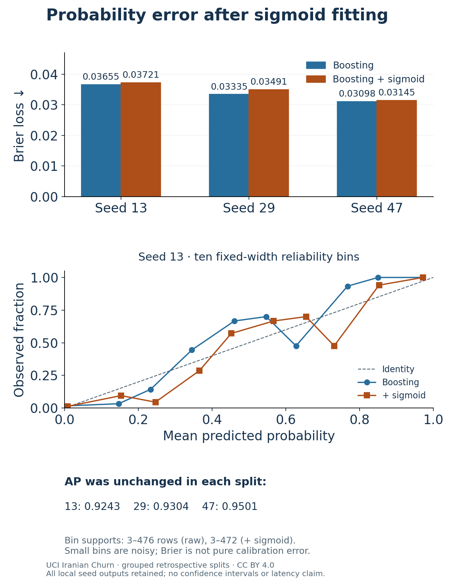
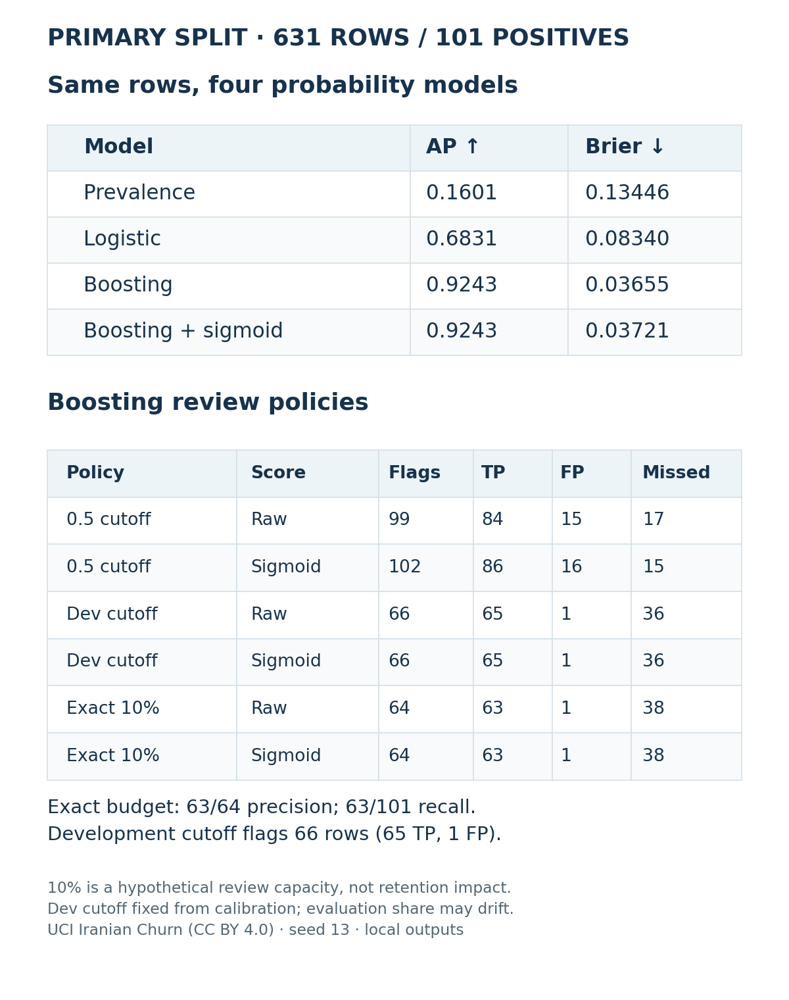

# From churn scores to a review queue: calibration, capacity and a useful negative result

A churn model returns a probability. A team still needs to decide what to do with it. A probability cutoff and a limited review queue are different policies, and an extra calibration step does not automatically make either one better.

I built Churn Decision Lab to make those differences inspectable. It is a local browser app for developers and analysts: load a safe example or your own appropriately licensed CSV, compare four probability models, set a hypothetical review budget, inspect the flagged rows, and export the same results as JSON or CSV. It requires no account or API key. Scoring stays on the local computer.

## Start with separate questions

Ranking asks whether observed churn cases tend to receive higher scores. Probability evaluation asks how well the numerical predictions match outcomes. A review policy asks which records enter a queue, and how many true positives, false positives and misses that creates.

These questions need separate evidence. I used average precision, Brier loss, reliability-bin summaries and explicit policy counts. Brier is not a pure calibration statistic: it combines calibration and discrimination. A lower value alone is not a complete explanation of why a probability model behaves differently.

## Freeze the evaluation before fitting

The experiment uses the UCI Iranian Churn dataset: 3,150 historical records under CC BY 4.0. The provider describes nine-month aggregated attributes and a month-12 churn label, separated by a three-month planning gap. Individual observation timestamps are absent, so I cannot present this as a chronological or prospective test.

I retained eleven numeric predictors and conservatively excluded Status and the derived Customer Value. Their operational derivation and availability were not verified here; exclusion does not establish that they are proven leakage. No target or identifier enters the predictor matrix.

Exact predictor duplicates stay in one partition, regardless of their labels. There are 2,826 distinct predictor groups. The primary seed, 13, was chosen before fitting: 1,875 rows for model fitting, 644 for calibration and cutoff setting, and 631 for evaluation. The evaluation partition contains 101 observed churn labels. Two additional prespecified seeds, 29 and 47, provide sensitivity checks. Their rows overlap, so they are not three independent replications or a basis for confidence intervals.

The fixed baselines are training prevalence, scaled logistic regression and histogram gradient boosting. A sigmoid calibrator is fitted on a separate partition using the already fitted boosting model. Neither the base model nor preprocessing is refitted on evaluation data. There is no hyperparameter search or test-label threshold optimization.

## The calibration hypothesis did not win

On the same 631 primary evaluation rows, the prevalence baseline has AP 0.1601 and Brier 0.13446. Logistic regression reaches AP 0.6831 and Brier 0.08340. Boosting reaches AP 0.9243 and Brier 0.03655.

Adding sigmoid calibration preserves AP at 0.9243 but worsens Brier to 0.03721. The same direction appears in the other declared splits: 0.03335 to 0.03491 for seed 29, and 0.03098 to 0.03145 for seed 47. AP remains unchanged within each split.

The result is mixed across probability metrics: primary log loss improves slightly, from 0.130406 to 0.130251, while it worsens in the other two splits. All these outputs remain in the repository. I would not describe this run as a successful probability-quality upgrade. The app keeps both scoring variants available; its default sigmoid view demonstrates the integration rather than a test-selected winner.

## A cutoff is not a queue size

At a 0.5 cutoff, raw boosting flags 99 records: 84 true positives, 15 false positives and 17 missed churn labels. After sigmoid fitting, it flags 102: 86 true positives, 16 false positives and 15 misses. The extra flags have a trade-off even though ranking AP has not changed.

For an exact hypothetical 10% review capacity, I select ceil(0.10 × 631), or 64 records, from scores only. Both variants select the same count and produce 63 true positives, one false positive and 38 misses. Precision is 63/64; recall is 63/101. This is a queue-budget result, not evidence that contacting those customers prevents churn.

A third policy fixes the top-10% cutoff from calibration scores and applies it unchanged to evaluation. It flags 66 records, with 65 true positives, one false positive and 36 misses. A fixed cutoff can drift away from the intended workload. Ties matter too: the prevalence baseline gives every record the same score, so its development cutoff flags all 631 rows. Exact-capacity ties instead use stable record-ID ordering.

## Try a concrete workflow

Run the documented benchmark and local server, load the authored synthetic example, switch between uncalibrated boosting and sigmoid scores, and change the exact budget. Then inspect the three flags before exporting. The ten demo records test the interface; they are not customer data or accuracy evidence.

The implementation checks duplicate-group separation, train-only preprocessing, independent metric/count calculations, finite probabilities, ties, rounding boundaries and malformed inputs. All 27 local numerical/API checks passed. Actual browser JSON and CSV downloads matched the API, displayed scores matched exported values to six decimals, and the layout and keyboard workflow were checked at a 390px viewport. This is bounded verification, not a comprehensive security or accessibility audit.

One practical data check also mattered: UCI's prose describes Charge Amount as 0–9, but the downloaded CSV reaches 10. The app accepts the observed range and records that discrepancy rather than silently rejecting legitimate source rows.

Reproduce the code, all seed outputs and original static figures: https://github.com/alirezarezaeei78/tabular-evaluation-lab/tree/main/churn

The limitation is substantial: one historical telecom dataset, fixed settings and no deployment study. Future analysis of these already inspected splits is exploratory reuse. Churn risk is not treatment benefit, and these results establish no revenue, retention or adoption gain.

Sources: Iranian Churn (2020), UCI, DOI 10.24432/C5JW3Z, CC BY 4.0: https://archive.ics.uci.edu/dataset/563/iranian+churn+dataset . Method/API and Brier caveat: scikit-learn 1.4.2 official calibration guide, matching the executed version: https://scikit-learn.org/1.4/modules/calibration.html .
