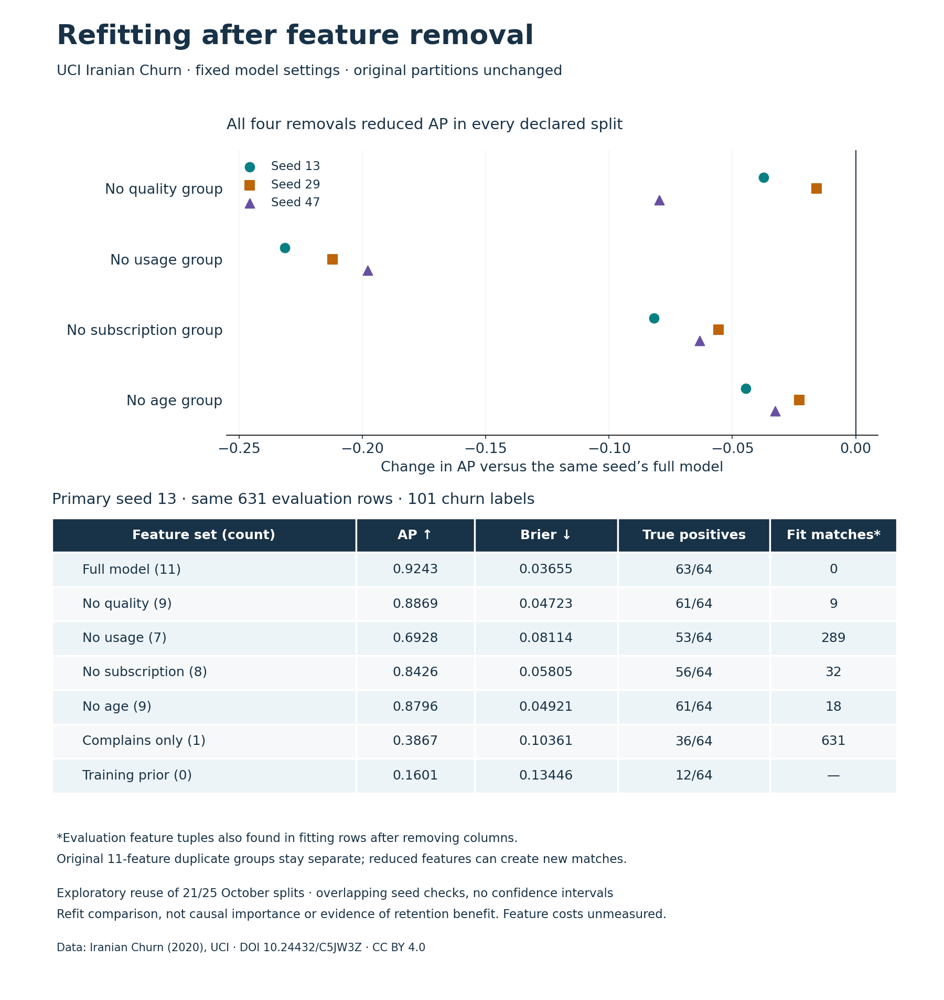

# Feature-group refitting study — 29 October 2026

This executed local study removes one **predeclared group**, refits the same
histogram gradient booster, and evaluates the same records. It compares conditional
predictive behavior, not causal importance or SHAP explanations. No new app is
required for this research contribution.

From repository root, Python 3.12.9 with the existing pinned dependencies:

```sh
python -m pip install -r churn/requirements.txt
python churn/feature_ablation.py run --output churn/local-output/my-ablation --audit-dir churn/.local/my-ablation-audit
python churn/feature_ablation.py inspect --seed 13 --export my-primary.csv
python churn/feature_ablation.py inspect --seed 13 --export my-primary.json
python -m unittest discover -s churn -p 'test_*.py' -v
python churn/render_feature_ablation.py
```

The inspect command reads published aggregates without downloading data, fitting
models or requiring paid services. The two export files contain the exact same
seven measured variants. Existing export/output/audit files are protected against
overwrite. The full run downloads the official provider input only if not cached,
verifies its hash, and requires the protocol hash to match the pre-fit freeze.
Model files, source-row mappings and predictions remain in the local audit.

The [protocol](PROTOCOL.md), [freeze record](protocol-frozen.json),
[sources/licences](sources.json), [complete results](results.json),
[flat summary](summary.csv), actual stdout and checks accompany this study.

All 18 fits completed their fixed 150 iterations. The full-feature model reproduced
the earlier boosting metrics exactly within 1e-12 for AP/Brier on all three original
splits. No calibration partition, evaluation error or test score was used to choose
model parameters or the one-feature reference. The latter selects the largest
absolute training-only feature/target correlation, then fits the same HGB budget.
`Complains` was selected in all three fitting sets.

Primary seed 13: full AP 0.9243 / Brier 0.03655; without usage AP 0.6928 /
Brier 0.08114. At an exact 64-record review capacity, true positives changed from
63 to 53. Usage removal produced the largest AP drop in each declared split;
every group removal worsened AP and Brier on each split. This is one retrospective
model/data/settings comparison, not a universal feature ranking. All variants,
including training prior and one-feature reference, remain in the full report.



**Material limitation:** the original eleven-feature duplicate groups are frozen
to preserve the matched historical partitions. Removing columns creates new
feature-equivalent records across fit/evaluation: e.g. 289 of 631 primary evaluation
rows after usage removal. Counts for every variant/seed are saved. This is not a
clean reduced-feature generalization test. Rerandomizing partitions here would
change the evaluation rows and the question. A separate prospective protocol/data
collection would be needed for a new validation claim.

The evaluation was exposed on 21 and 25 October. Seeds 29/47 are overlapping
sensitivity checks, not independent replications or confidence intervals. Do not
select a deployed feature set from these results. No row timestamps support a
prospective temporal claim. Status/Customer Value remain conservatively excluded;
their availability was not verified. Collection costs, latency and causal effects
of a retention intervention were not measured. A lower Brier loss is probability
error, not a calibration-only decomposition.

Dataset: Iranian Churn (2020), UCI Machine Learning Repository,
[DOI 10.24432/C5JW3Z](https://doi.org/10.24432/C5JW3Z), **CC BY 4.0**.
Authored code and original figures: repository MIT. Public assets contain only
aggregates and hashes, not source data, fitted models or reconstructable records.
