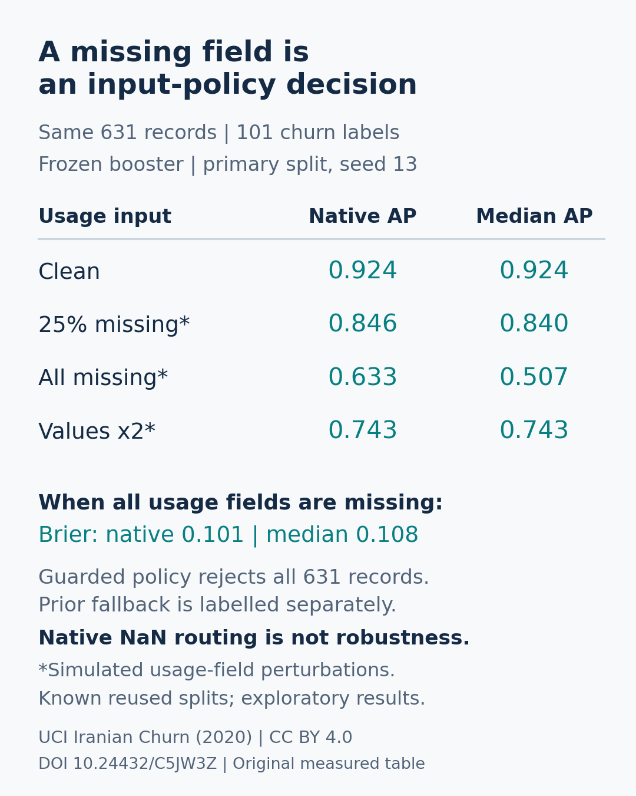

# Churn Decision Lab: missing-input stress reports

New model-backed local CLI/API extension: choose how missing numeric inputs are handled, inspect per-record flags and model-versus-fallback probabilities, then export matching JSON and CSV. It reuses the existing Churn Decision Lab's feature schema, original grouped partitions, model settings and numerical metric checks. No paid key, network inference or hosted demo is required. The source, aggregate results and authored demo are reproducible locally; no hosted demo is claimed.

## Reproduce and run

Python3.12.9 was used. Create/activate a disposable environment, then:

```text
python -m pip install -r requirements.txt
python source/fetch_input.py private-input/iranian-churn.csv
python source/stress_report.py evaluate --data private-input/iranian-churn.csv --previous reference-results.json --protocol PROTOCOL.md --output my-results --audit my-private-audit
python source/stress_report.py score --input synthetic-demo.csv --bundle my-private-audit/model-13.joblib --policy guarded --json my-report.json --csv my-report.csv
python -m unittest discover -s source -p test_stress_report.py -v
```

The provider input is downloaded locally and checked against the frozen CSV hash. Existing input/output/audit paths are protected; choose new names when reproducing. `reference-results.json` contains compact aggregate original split/clean-metric evidence from the21October immutable contribution, not provider rows. The full experiment refits the same clean-data booster per seed and checks that the known split hashes and clean AP/Brier reproduce. Do not treat this known evaluation as an independent test.

**Load only your own locally reproduced model bundle.** Joblib unpickling can execute code; the app does not offer uploaded or publicly redistributed model binaries. Provider input, models and row-level prediction records remain private/local; public release is code/hashes/aggregates with data attribution. The supplied `synthetic-demo.csv` contains three explicitly authored records: complete input, missing usage fields, and out-of-range age999. It contains no actual UCI customers. Actual CLI outputs in `demo-*.json/.csv` are engineering examples, not accuracy evidence.

For API use from the source directory, import `read_input`, `score_array`, `csv_text` and `write_outputs` from `stress_report`. Schema and outputs are shared by CLI/API. `native` uses the original booster and its built-in NaN routing; `median` fills missing cells with fitting-only medians before the same model; `guarded` rejects missing/out-of-fitting-range inputs and reports a separate fitting-prevalence fallback. It never presents that fallback as the individualized model probability. Flags remain visible even when native/median continue scoring. A value inside fitting extrema is not proof of reliable inference; the guard is intentionally simple.

All eleven exact feature columns are required. Empty cells mean missing. Optional `record_id` must be unique and safe; optional `Churn` is used only for descriptive evaluation after scoring, never as a predictor. Unknown/duplicate/ragged headers, empty files, missing columns, nonnumeric text and nonfinite literal values are rejected. Input limits:1MB and5,000rows. CSV/JSON outputs are distinct, preserve existing files, and cannot replace the input/model. There is no browser UI in this extension, so no mobile-browser claim.

## Frozen real-data evaluation

`PROTOCOL.md` and `protocol-frozen.json` record the question and all conditions before new fitting/results. Three clean-data HGB fits use the original seeds13,29,47, original eleven-predictor duplicate groups and original fitting/calibration/evaluation partitions. Status and Customer Value remain excluded; the calibration partition is retained but unused. Fit-only medians/minima/maxima and label prevalence define the policies. No corruption fitting, evaluation-based selection or new calibrated model is performed.

Four conditions per seed: clean; all four usage inputs absent on every evaluation record; those fields absent on a seeded floor(25%*N) subset; and all usage fields multiplied by2. These are simulated input failures, not observed production drift frequencies. The same records and labels enter every all-row comparison. All12policy/condition combinations per seed, baseline priors and accepted-only support counts are retained. Results with accepted-only denominators must not be compared as though they cover all records.

Primary seed13,631evaluation records with101churn labels:

| Condition | Native AP | Median-fill AP | Native Brier | Median Brier |
| --- | ---: | ---: | ---: | ---: |
| Clean |0.924274|0.924274|0.036547|0.036547|
| Usage absent on seeded25% subset |0.845616|0.840060|0.051716|0.052646|
| Usage absent on all records |0.632748|0.507030|0.101244|0.108146|
| Usage values multiplied by2 |0.742662|0.742662|0.085020|0.085020|

When usage is absent everywhere, the guarded model coverage is0/631 and all records receive the separately labelled constant prior fallback. That fallback AP is0.160063, Brier0.134462; no model prediction is fabricated. Under clean inputs the simple guard rejects2records; under doubled usage it rejects174/631, none of the101positive labels. Its all-row fallback AP falls to0.634760 and Brier0.091705. A rejection policy is not automatically better; positive class mix and coverage change.

The native model's all-usage-missing AP was0.646328 and0.663319 on seeds29/47 versus clean0.930401/0.950134. Complete values, capacity TP/FP/FN/precision/recall, accepted/rejected positives and all original split hashes remain in `results/results.json`. There is no confidence interval, speed comparison, SOTA or causal retention claim. Repeated exposed historical partitions, overlapping seed checks, artificial corruption and one small dataset limit generalization. The feature expresses what the app does under an input failure; it does not certify operational reliability.



## Checks, failures and credit

13new numerical/schema/workflow tests pass. Actual CLI runs exercised all three policies on the authored demo. All36real evaluation JSON/CSV pairs, covering22,812record exports, were checked for exact numeric/null/boolean/flag/identity parity. AP uses a separately written threshold-group oracle; Brier uses scalar sums; exact-capacity order/counts are independently checked. All3clean models reproduced earlier AP/Brier within1e-12 and retained duplicate-group separation. Saved local model replays were exact. A joblib physical-core query warning on Windows is preserved; numerical fitting remained limited to one thread. Its traceback is environmental warning output, not a failed fit or hidden negative result.

Nonfinite literal CSV cells fail at parser validation; blank missing cells are handled by the selected input policy. No raw records or model binaries are public. There is no claim that an in-range input is safe or that median filling improves accuracy.

Data: Iranian Churn (2020), UCI Machine Learning Repository, [DOI10.24432/C5JW3Z](https://doi.org/10.24432/C5JW3Z), [CC BY4.0](https://creativecommons.org/licenses/by/4.0/). Primary method: [scikit-learn1.4.2 HGB and native NaN routing](https://scikit-learn.org/1.4/modules/generated/sklearn.ensemble.HistGradientBoostingClassifier.html). Established methods, no recent-paper result claimed. Existing `churn_lab.py` derives from the owner's `tabular-evaluation-lab` immutable commit5a7fc1f2f52ff91f0c8074daca047c12902b555b; preserve its MIT notices. New code and original figure are MIT, copyright2026AlirezaRezaei; provider data retains separate CC BY terms. See source/licence and hash records.
