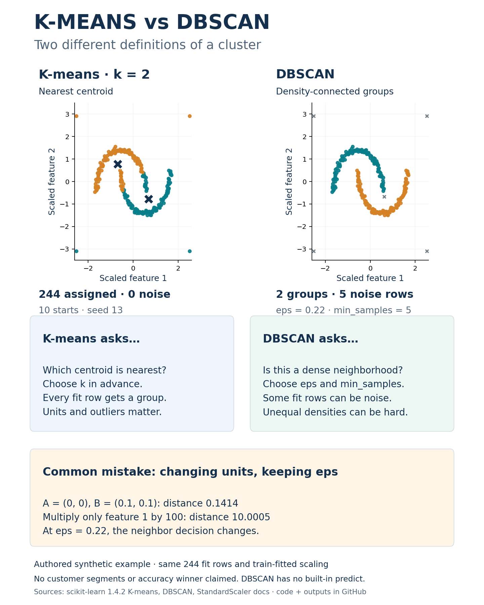

# K-means vs DBSCAN: what each calls a cluster

An executed educational comparison with original synthetic points and a checked visual. This is established teaching, not real customer segmentation, scientific novelty, independent evaluation or a claim that one algorithm is universally better. It belongs to this repository's education collection; the planned real-data RFM app remains separate and deferred.

## Run

From this directory:

```sh
python -m pip install -r requirements.txt
python -m unittest -v test_example.py
python example.py --output outputs
python render.py
```

The run needs no account, key, dataset download or network call. The saved outputs contain authored synthetic coordinates, both fitted label arrays, scaled values, K-means probe predictions, centroid/scaler parameters, complete method configuration, checks, environment and hashes. DBSCAN is not given a fabricated out-of-sample predict method. Source assets and PNG/SVG remain editable through render.py. Code and authored synthetic assets use the root MIT licence.

## What the example teaches

Both methods use exactly244 authored fitting rows, after StandardScaler fitted only to those rows. Preset K-means uses k2,10starts and seed13. Preset DBSCAN uses Euclidean eps0.22 and min_samples5. No parameter search, generator replacement or choosing an appealing result after fitting.

- K-means assigned244rows to2groups. Independent nearest-centroid assignments and summed squared-distance inertia match the estimator(inertia225.35006525375397).
- DBSCAN found2core-connected groups with237core rows,2border rows and5noise rows. A separately implemented dense-distance/BFS oracle checks neighborhoods, core components and border/noise membership without relying on arbitrary group numbers.
- A two-point fixture independently checks that min_samples counts the point itself. Duplicates, empty/invalid/nonfinite shapes, determinism and full-precision CSV roundtrips are checked.
-84separate generated probes only use the learned transform; changing them cannot alter fitted scaling or centers. K-means predictions are saved. Scikit-learn DBSCAN has no built-in predict, so no held-out DBSCAN labels or accuracy result are invented.

Colors are method-specific cluster IDs, not known customer types. Dark largeX marks centroids; gray small crosses mark DBSCAN noise. The nonconvex shape was deliberately chosen to illustrate different grouping rules. This visual does not estimate deployment quality or show that DBSCAN wins on business data. Its eps can fail with varying densities. K-means is sensitive to units/outliers and initialization.

## The worked units trap

A=(0,0),B=(0.1,0.1): Euclidean distance is0.1414213562. If only feature1 is expressed in units100times larger, distance becomes10.0004999875. At fixed eps0.22, the neighbor decision changes. The scalar arithmetic is executed. Positive unit conversion followed by a separately fitted StandardScaler produces the same standardized fitting coordinates to1e-12. Scaling is still a modeling choice; it is not universally appropriate or robust to outliers.

Try modifying scaling and eps in a separate exploratory copy, then inspect which rows change from group to noise. Preserve these frozen original outputs. Choose the feature meaning and distance metric before interpreting a colored plot as a business segment.



See[PROTOCOL.md](PROTOCOL.md),[sources.json](sources.json) and[actual outputs](outputs/results.json). Primary method sources are matching scikit-learn1.4.2 official K-means, DBSCAN and StandardScaler documentation, linked in the ledger. Seven meaningful behavior/numerical tests passed locally; this is not a performance metric. No latency, business benefit, customer identity or adoption claim.
