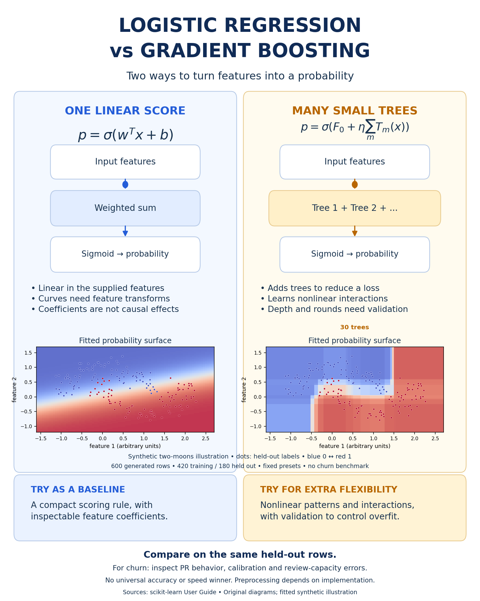

# Logistic regression versus gradient boosting: a visual tutorial

An original comparison infographic and a silent 20-second animation for learning how two binary classifiers form scores. The moving dots are schematic data flow. The right-hand probability surface replays actual fitted boosting stages 1, 5, 10, 20 and 30; animation duration is not training time.



Logistic regression is linear in the supplied features at the log-odds level. Feature transformations can give it nonlinear boundaries in the original coordinates. Gradient boosting builds an additive tree model; additional flexibility needs validation rather than an assumption of better performance. Coefficients are not causal effects, and output probabilities are not certified calibrated confidence.

## Reproduce

Python 3.12 was used. From this directory, in a virtual environment:

```sh
python -m pip install -r requirements.txt
python compare.py --output my-run
```

The output directory must be new. The script fits both models and executes 12 checks, including disjoint partitions, train-only scaling, an independent average-precision calculation with ties, linear-logit additivity, reconstruction of boosting scores from actual tree leaves, final staged-output parity and same-seed rerun parity. Saved CSVs contain all authored synthetic inputs and held-out predictions. No private or downloaded customer data is used.

To rebuild the published media, `render.py` reads `outputs/render-data.npz` and writes PNG/SVG, MP4 and first/middle/last animation frames. Its FFmpeg executable comes from the installed `imageio-ffmpeg` package.

```sh
python render.py
```

The render script intentionally replaces this tutorial's generated media files. It does not modify model inputs or other repository work. Core fitting/evaluation does not require FFmpeg or a browser.

## Scope and evidence

The [protocol](PROTOCOL.md) fixes 600 generated two-moons observations, generator seed 13, noise 0.18, a stratified 420/180 split with seed 29, and all model settings before execution. Logistic regression uses train-only StandardScaler and C=1. Boosting uses 30 depth-two trees and learning rate 0.1. There is no hyperparameter search.

The nonlinear synthetic task is deliberately chosen to make scoring geometry visible. It is not a churn dataset, independent real-world model comparison, timing benchmark or evidence of a universal winner. Actual diagnostics and versions are in [results.json](outputs/results.json), with [held-out predictions](outputs/predictions.csv), [data](outputs/data.csv) and saved render arrays. Positive-class probabilities share a fixed 0–1 color scale; scatter points are the same held-out labels on both panels.

The current run passed 12 checks. No statistical intervals, deployment claim, business savings or scientific novelty are asserted. A real churn comparison needs a prediction-time feature audit, appropriate held-out groups/time, task metrics, calibration and a declared review-capacity policy.

## Sources and licence

The [source ledger](sources.json) records the official scikit-learn logistic and gradient-boosting methods. The executed runtime is scikit-learn 1.4.2; current stable documentation was also checked, with no claim that this run used the latest release. The reference images supplied for layout inspiration are not copied or redistributed here. All diagrams, drawing code and synthetic media/data in this tutorial are newly authored under the repository's MIT licence. Dependencies retain their own licences.
