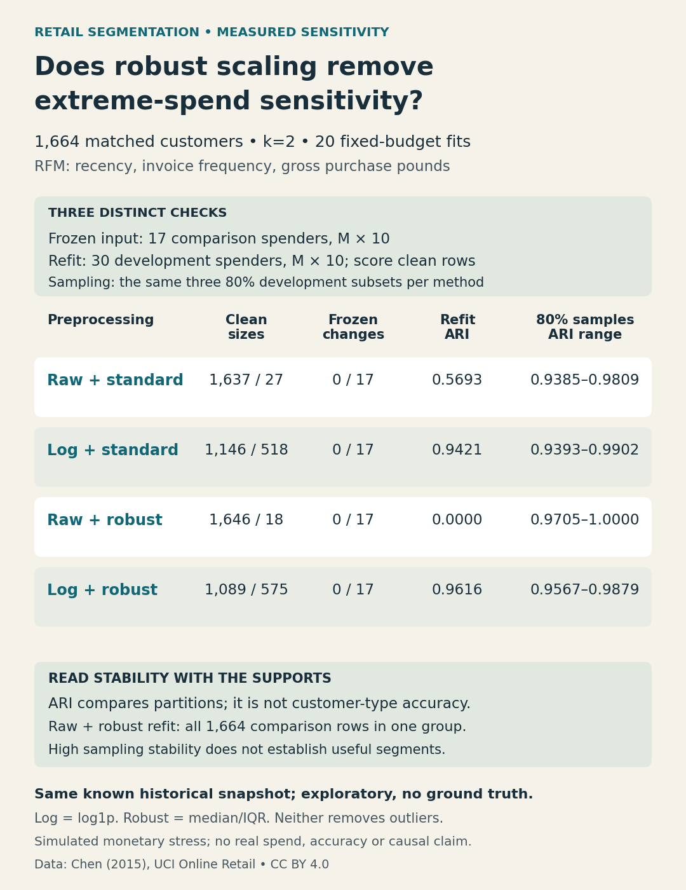

# Retail preprocessing and extreme-spend sensitivity

**A median/IQR scaler does not turn squared-distance k-means into an outlier-robust
objective.** This executed historical sensitivity study separates frozen inference,
training-data stress/refits and customer sampling. It has no customer-type ground
truth and does not select a best segmentation from these results.

Twenty fixed-budget fits compare four preprocessing pipelines on identical
development and comparison customers. All methods use k=2, KMeans seed13,
n_init10, max_iter300, tol1e-4, Lloyd, CPU/thread limit1. k was fixed from the known
5November development-only selection, before this comparison; it was not retuned
per representation. The historical data are already exposed, not new validation.

## What was executed

UCI Online Retail: Chen,D.(2015), DOI10.24432/C5BW33, CC BY4.0. Positive-purchase
RFM uses recency in fractional days, distinct invoice frequency and gross pounds.
Development is [2010-12-01,2011-07-01):2960customers. Comparison is the180day window
ending before2011-12-01, restricted to1664customers active in all30/90/180day
windows of the known earlier study. Of these,591were absent from development.

Transform alternatives are raw RFM or elementwise log1p, followed by either
StandardScaler (development mean/population standard deviation) or RobustScaler
(development median/IQR,25th–75th percentiles). No clipping or removal of outliers.

1. **Frozen input stress:** multiply only monetary value by10 for the17 largest
   spenders (ceil1%) in the comparison snapshot, holding all fitted parameters
   fixed. Every other feature/row remains unchanged. All four methods retained
   every label. This one constructed probe does not guarantee robustness.
2. **Training influence:** multiply monetary value by10 for the30 largest spenders
   in development, then refit each entire preprocessing/KMeans pipeline with the
   same settings. Predict the unchanged1664comparison rows. These are simulated
   inputs, not observed spending changes or a causal intervention.
3. **Sampling:** refit each entire clean-data pipeline on the same80% development
   subsets, sampling seeds13,29,47. KMeans seed13 stays fixed. Compare all resulting
   partitions on the same1664clean comparison rows. Ranges are descriptive across
   three overlapping subsamples, not uncertainty intervals.

Tie-breaking for largest spenders is customer ID ascending. All features, rows,
stress sizes, seeds and fit budgets were frozen in [PROTOCOL.md](PROTOCOL.md).

| Preprocessing | Clean sizes, large/small | Frozen changes /17 | Training-stress refit ARI | 80% sampling ARIs, range |
|---|---:|---:|---:|---:|
| Raw + standard | 1637 /27 | 0 | 0.569293 | 0.938515–0.980903 |
| Log + standard | 1146 /518 | 0 | 0.942055 | 0.939346–0.990199 |
| Raw + robust | 1646 /18 | 0 | 0.000000 | 0.970529–1.000000 |
| Log + robust | 1089 /575 | 0 | 0.961582 | 0.956727–0.987896 |

The raw/robust training-stress refit still had two nonempty development clusters,
but assigned **all1664unchanged comparison rows to one group**. Its label-aligned
agreement with the original comparison partition is0.989183 because that partition
was already1646/18; ARI is0. A high agreement percentage or sampling stability
alone can hide a nearly empty segment. Inspect supports and profiles too.

Representation also changed the clean partitions: ARI versus log/standard was
-0.016593 for raw/standard, -0.011333 for raw/robust and0.865788 for log/robust.
These are agreement metrics between methods, not accuracy against customer types.
All full-precision metrics, contingencies, convergence and suppressed profiles are
in [results.json](results.json); every fitted model had two development groups and
converged before max_iter, with no primary fit warning.



## Reproduce locally

Use Python3.12. Fetch the original `Online Retail.xlsx` locally from
[UCI](https://archive.ics.uci.edu/dataset/352/online+retail), unzip the download and
keep provider files outside the public source tree. The exact Excel SHA256 is
`43465a06f2ccf7c8b5bd2892bc7defb52f97487934fe93b16ae4c3936424676d`.

From the repository root:

```sh
python -m pip install -r requirements-retail-extremes.txt
python -m unittest -v test_retail_extremes
python -m unittest -v
python retail_extremes.py --data "LOCAL_DATA/Online Retail.xlsx" --audit local-output/retail-private --output local-output/retail-results.json --protocol retail-extremes/2026-11-12/PROTOCOL.md
python render_retail_extremes.py
```

The renderer uses the archived completed result JSON. Compare a fresh run's output
with that archive before replacing any recorded artifact. Rerun output paths keep
the original evidence intact. No API key, paid service, GPU or model download.
LOKY_MAX_CPU_COUNT=1 is set inside the process for the declared one-CPU budget and
to avoid optional Windows physical-core probing; threadpool limits are also1.

Nine new tests and53root regression tests passed locally. Independent checks cover
scalar transaction aggregation, exact-rational ARI, optimal label matching,
direct scaler statistics and distances/inertia, same-row/sample hashes, preserved
source arrays, JSON model reload and full-precision CSV round trips. An additional
audit checked33280saved-model predictions; all39936condition predictions are
recorded privately. These are correctness counts, not predictive evidence.

Raw transactions, customer IDs, row predictions and fitted parameters stay local.
The public release includes code, hashes, aggregate results, source/licence ledger,
actual stdout, checks and editable original SVG. Profiles with fewer than10rows
are suppressed. Required dataset credit remains in [sources.json](sources.json).

## Limits and useful action

The cleaning retained397884of541909provider lines. Sequential exclusions were
135080invalid customer IDs,8905cancelled invoices and40nonpositive/invalid prices;
later quantity exclusions were0after those earlier gates. Exact duplicates5268
remain by policy; invoice frequency counts distinct invoices. Return/cancellation
amounts are excluded rather than netted, so monetary is not profit, net revenue,
customer value or lifetime value. Provider timestamps are naive; no UTC assertion.

The comparison snapshot overlaps development and is conditioned on recent activity.
Reused, overlapping historical cohorts and three samples are not independent
validation, real drift prevalence or confidence intervals. No marketing action,
customer label, business gain, runtime comparison or optimal k/scaler is claimed.
Each representation changes geometry; inertia across those geometries is not a
quality ranking. This extends the earlier window-sensitivity question with new
preprocessing and stress/refit comparisons; no deferred app is claimed complete.

Before naming segments, freeze preprocessing and stress the fitted assignment
path separately from the refit path. Compare supports, profiles and matched-row
stability against the actual use case; stability alone does not establish utility.
