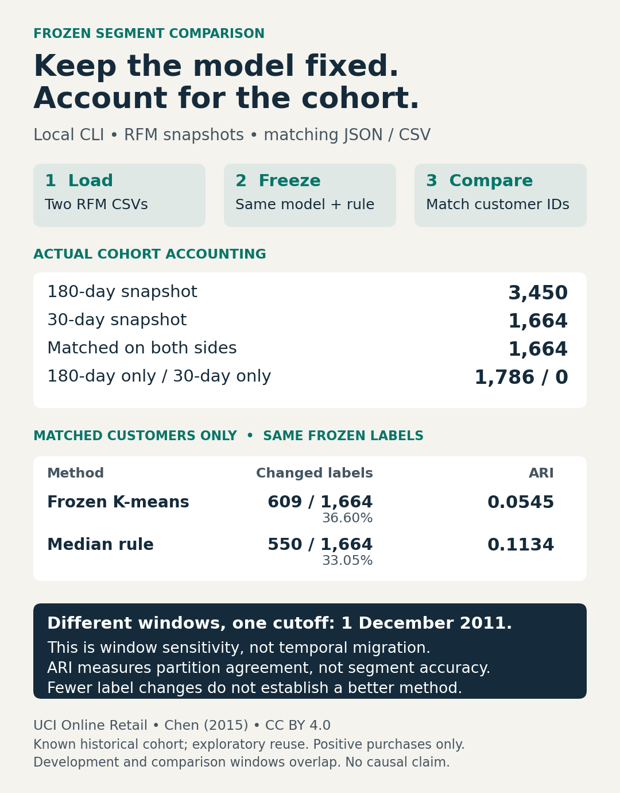

# Compare two RFM snapshots through one frozen segmentation model

A local command for analysts and ML developers who need to inspect which
assignments changed without hiding customers absent from either snapshot.
Load two CSVs and a frozen JSON model, inspect matched/unmatched accounting,
then export the same assignments, transitions and profiles. No upload service,
paid key, hosted demo or browser UI is involved.

## Run the authored synthetic demo

From the repository root, with Python 3.12:

```sh
python -m pip install -r requirements-retail-extremes.txt
python segment_snapshot.py --left snapshot-comparison/2026-11-18/demo/left.csv --right snapshot-comparison/2026-11-18/demo/right.csv --model snapshot-comparison/2026-11-18/demo/model.json --output local-output/my-snapshot-comparison
```

This executed example has 16 customers per side, 12 matched, four left-only and
four right-only. Both methods change two matched labels; ARI is
0.3956043956043956. The supplied model was fitted to 24 authored synthetic
development rows (seed13, k2, n_init10); it contains no provider parameters.
All synthetic inputs, development rows and expected exports are in `demo/`.
Use a new output directory for each run. Success exits 0; invalid input or
existing output exits 2. The command never refits the model.

Outputs:

- `report.json`: input/model byte hashes, cohort accounting, metrics, transitions,
  raw RFM profile medians/supports and explicit undefined-metric statuses.
- `assignments.csv`: one row per union ID, matched/left-only/right-only status,
  both methods' side-specific labels; absence stays empty, never label zero.
- `transitions.csv`: all four 0/1 transition cells per method, matched IDs only.
- `profiles.csv`: per-side all-row and matched-row profiles; medians suppressed
  for supports below10. These export the same profile records as JSON.

Inputs remain local and unchanged. Keep outputs derived from private inputs
private; hashes and aggregate profiles do not guarantee anonymity.

## Frozen model and input contract

CSV header is exactly `CustomerID,R,F,M`. IDs are unique exact strings (no Unicode
normalization, trimming or case folding), nonblank, without surrounding
whitespace and at most128 characters. R is finite nonnegative recency in days;
F is finite positive integer invoice frequency; M is finite positive monetary
value. Use the same units/cleaning/feature definitions and a documented window
on both sides. Limits: 5MB and50,000 rows per input; model JSON at most100KB.
Header-only snapshots are valid. Invalid, ragged, duplicate or nonfinite inputs
fail. There is no automatic imputation or silent row filtering.

The `frozen-rfm-v1` JSON schema (see the synthetic model) stores method
`log_standard`, three development-only log1p means/scales, two transformed
K-means centers and three raw development medians. Finite positive scales are
required. Prediction uses squared Euclidean distance; exact ties choose label0.
The baseline assigns1 if at least two of R<=medianR, F>=medianF and M>=medianM
hold, otherwise0. Equalities are intentional. This rule is not ground truth.
The two methods' label IDs have separate meanings; no cross-method label-change
comparison is reported. A JSON model accepts numeric parameters, never pickle.

Both snapshots use the **same** frozen model hash. Changed-fixed-label share and
ARI use the exact common IDs in deterministic order. No arbitrary refit-label
alignment is used. ARI is null for fewer than two matches; changed share is null
when no IDs match. A single matched row has a defined change share but no ARI.
Left/right-only counts remain visible and are excluded from transition metrics.
No unmatched customer is called churned or lost.

## Executed historical retail workflow

We recovered the clean log1p/StandardScaler/K-means k2 model from the
[12 November release](../../retail-extremes/2026-11-12/README.md), without refitting.
Its development window is [2010-12-01,2011-07-01),2960 customers. The fixed rule
uses medians from those same development rows. We then compared full180-day
and30-day purchase windows ending2011-12-01, under identical frozen parameters.

| Cohort accounting | Count |
| --- | ---: |
| 180-day snapshot |3450|
| 30-day snapshot |1664|
| Matched |1664|
| 180-day only |1786|
| 30-day only |0|

Only48.23% of the left snapshot is matched; all right-side customers are matched.
The1786 unmatched customers lack retained purchases in the shorter window; this
does not establish departure, churn or a permanent customer state.

| Method | Changed matched labels | Share | ARI |
| --- | ---: | ---: | ---: |
| Frozen log + standard K-means |609/1664|36.60%|0.054482294546552124|
| Frozen development-median rule |550/1664|33.05%|0.11342822468396115|

The K-means transition counts are0→0:518,0→1:0,1→0:609,1→1:537.
The rule counts are331,0,550,783 respectively. Complete supports/profiles and
full precision values are in [results.json](results.json).

**These are observation-window sensitivity results at one cutoff, not temporal
customer migration.** Shorter histories change frequency/monetary inputs. ARI
measures partition agreement, not customer-type accuracy; fewer changes or higher
ARI do not establish a better segmentation. Group labels have no business names.
The model need not be suitable for this shorter window.



## Reproduce and check

```sh
python -m unittest -v test_segment_snapshot.py
python render_snapshot_comparison.py
```

For the provider workflow, fetch the licensed Excel locally and reproduce the
12 November experiment following its README. Retain its private `models.json`,
`development-rfm.csv` and `predictions.csv`. Then run, from the repository root:

```sh
python run_snapshot_evaluation.py --provider "local-data/Online Retail.xlsx" --old-models local-output/retail-audit/models.json --development local-output/retail-audit/development-rfm.csv --reference-predictions local-output/retail-audit/predictions.csv --audit local-output/snapshot-audit --public local-output/snapshot-results
```

The new evaluation ran successfully. All1664 prior reference predictions matched
the recovered model; independent scalar RFM, recovered-pipeline and median-rule
checks passed. API/CLI JSON and all three CSV exports were byte-identical on the
provider workflow. Nine new tests cover hand-calculated ARI/joins/transitions,
row order, empty/disjoint/single matches, malformed rows/models, profile medians,
export parity and real CLI success/error behavior. All62 relevant new/existing
checks passed; actual logs are included. This is correctness evidence, not an
independent enterprise or predictive-quality validation.

See [frozen protocol](PROTOCOL.md), [freeze receipt](protocol-frozen.json),
[sources/licences](source-licence-ledger.json), [actual CLI stdout](benchmark-stdout.txt)
and [test log](all-tests-stdout.txt). `run_snapshot_evaluation.py` generates the
safe demo from authored rows; do not overwrite the committed expected fixture
directory in place—choose a new `--public` destination when reproducing.

## Data and limitations

Chen,D.(2015). Online Retail. UCI Machine Learning Repository.
DOI10.24432/C5BW33, CC BY4.0. Provider transactions, IDs, per-customer predictions
and fitted parameters stay local; public results are aggregate. Code and authored
synthetic fixtures are MIT-licensed; third-party notices remain unchanged.

Cleaning reuses positive quantities/prices, non-cancelled invoices, valid naive
timestamps/customer IDs; exact duplicate lines are retained. Frequency counts
distinct invoices, recency uses fractional days, M sums gross positive purchases
in pounds. Returns are excluded, so M is not net revenue/profit/lifetime value.
Known development/comparison customers and windows overlap; this benchmark was
already exposed on5/12November. No independent holdout, causal claim, scientific
novelty, speed benchmark or production-readiness claim. This is a new model-backed
comparison workflow around recoverable existing parameters.
